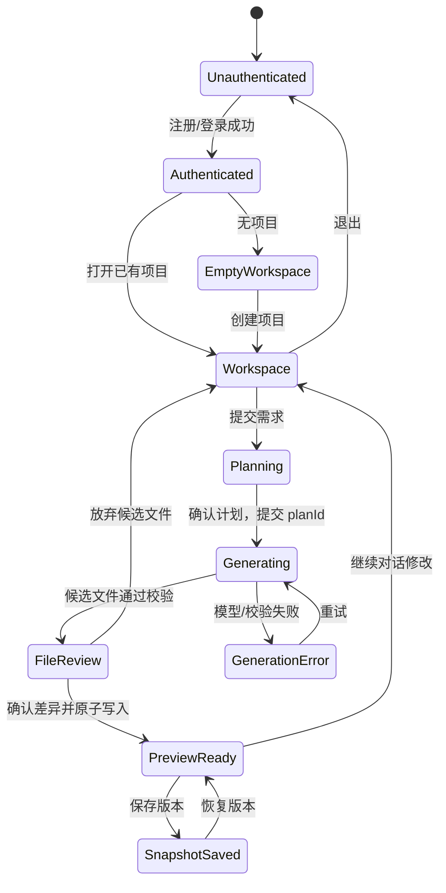
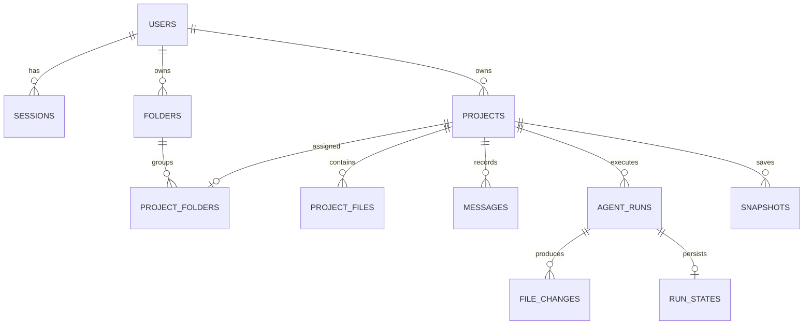

# Stars Demo 需求文档

## 1. 文档信息

| 项目 | 内容 |
| --- | --- |
| 产品名 | Stars |
| 文档类型 | 产品需求、技术边界与验收规格 |
| 参考产品 | [Atoms 中文站](https://atoms.dev/zh)、[Atoms AI Agents](https://atoms.dev/zh/ai-agents) |
| 目标交付 | 可登录、可持久化、可通过自然语言驱动代码生成并在线预览的网页应用 |
| 当前仓库状态 | 已加入计划/候选审核、持久化运行事件、质量门禁及文件夹/附件/语音/账户交互；本批本地 API 22/22 和扩展浏览器回归通过 |
| 线上版本 | [https://39.107.41.101/](https://39.107.41.101/) 已切换至 `20261024T093929Z-workbench`，云库迁移 004 与公网工作台 10 项烟测通过；本批真实模型调用为 0，SMTP/Cloudflare/真实麦克风未复测 |
| 目标部署主机 | `39.107.41.101`（按 IPv4 主机地址处理） |
| 参考站观察时间 | 2026-10-22（公开未登录页面） |

### 1.1 使用方式

本文档与 `development-plan.md` 配套使用。需求中的“必须”是上线验收条件；“建议”是实现基线，可在技术评审中调整，但调整必须记录原因和影响。

### 1.2 安全说明

对话中提供了服务器和 MySQL 的登录信息。本文档不复制明文密码，也不允许把它们写入仓库、前端代码、镜像、日志或截图。MySQL 已创建独立的 `stars_demo_workbench` 数据库和只具备业务表 `SELECT/INSERT/UPDATE/DELETE` 权限的应用账号；轮换对话中暴露的服务器 root 和数据库管理凭据仍是后续安全事项。应用运行时不得使用 `root` 数据库账号。

## 2. 产品目标与范围

Stars 是一个面向非专业开发者和小型团队的 AI 应用生成工作台。用户描述想法，Stars 的智能体完成需求澄清、方案规划、前端代码生成和基础验证，用户在同一界面查看文件、预览应用、继续修改，并在刷新或重新登录后恢复项目。

### 2.1 MVP 必须覆盖

1. 注册、登录、退出和会话恢复。
2. 创建、列出、打开和删除自己的项目。
3. 在项目中输入自然语言需求。
4. 通过真实模型服务生成至少一套可运行的 `HTML/CSS/JavaScript` 文件。
5. 流式显示智能体阶段、消息和文件变更。
6. 在隔离预览区运行生成的应用，至少支持页面按钮、表单校验、选项卡或筛选等一种真实交互。
7. 持久化用户、项目、消息、文件、智能体运行记录和版本快照。
8. 刷新页面、重新登录后恢复项目状态。
9. 一个延展能力：版本快照、差异查看和恢复。
10. 在公网可访问的 HTTPS 地址完成验收。

### 2.2 明确不在 MVP

- 任意服务器命令执行、任意 npm 包安装或生成项目的服务端编译。
- 多租户团队计费、支付、广告投放、SEO 自动发布、GitHub 写入。
- 生成应用直接访问 Stars 主站 Cookie、数据库或内部 API。
- 复制 Atoms 的品牌素材、源代码、私有接口或未公开实现。

## 3. REA 逆向工程结论

本节只记录公开页面可观察到的证据。营销文案不等于已验证实现；没有直接证据的内容标为“待确认”。Stars 采用相同的交互意图，但使用自己的名称、文案和实现。

### 3.1 观察方法

采用 REA 的“证据优先”流程：

1. 记录页面、控件、可见文本和链接。
2. 对每个可操作控件观察点击前后的状态变化。
3. 将状态变化整理为用户路径、状态机和数据对象。
4. 将公开页面中的声明与实际观察分开；无法确认的内部实现不做推断。

### 3.2 公开页面证据

| 编号 | 页面与观察 | 对 Stars 的设计影响 | 证据等级 |
| --- | --- | --- | --- |
| E1 | [首页](https://atoms.dev/zh) 首屏包含品牌导航、登录/注册、自然语言输入框和“开始”入口 | Stars 首屏必须直接进入需求输入，不放营销长文作为第一操作 | 已观察 |
| E2 | 首页有“Atoms 能构建什么？”示例卡片；点击“预览 网站展示”后出现带“克隆/关闭”的对话框和 iframe 预览 | Stars 需要示例项目预览、独立预览容器和“基于示例创建项目”的明确入口 | 已观察 |
| E3 | 注册页提供 Google 继续和邮箱继续；继续按钮在邮箱为空时禁用，并展示服务条款、隐私政策链接 | Stars 注册页需要显式禁用态、条款链接和可诊断错误 | 已观察 |
| E4 | [AI Agents 页](https://atoms.dev/zh/ai-agents)列出 Team Leader、Product Manager、Architect、Engineer、Research、SEO、Ads、Data 等角色 | Stars MVP 采用少量可见阶段，内部角色可按 Product、Architect、Engineer、QA 映射，不承诺复刻八个角色 | 已观察 |
| E5 | AI Agents 页强调“一条提示词”、多智能体工作流、重要步骤征求批准 | Stars 需要一个主输入框、阶段状态流和高风险动作的人工确认点 | 已观察/营销声明 |
| E6 | 页面声明包括可视化编辑器、云后端、代码导出、竞速模式和 AI 集成 | Stars MVP 先实现文件树、隔离预览、快照恢复；导出与多模型竞速列为后续路线 | 已观察/待确认实现细节 |
| E7 | 首页有价格切换、FAQ 折叠、多个 CTA | Stars 需要可复用的折叠和加载/禁用状态，但不在 MVP 实现计费 | 已观察 |
| E8 | 示例预览对话框包含“克隆”；未登录时选择克隆会跳转至登录页 | Stars 对示例提供“预览”和“基于示例创建”入口；未登录时先登录，再返回原目标 | 已观察 |
| E9 | [Team Leader 详情页](https://atoms.dev/zh/ai-agents/team-leader-agent)描述按顺序拆计划、分配角色，并在方向、范围、技术栈和发布等节点暂停待批准；线程显示决策、阻塞、进度 | Stars 工作台应提供可读的阶段事件、审批卡和决策记录；审批仅用于生成计划及后续外部副作用 | 已观察官网描述，未登录工作台未验证 |
| E10 | [模型页](https://atoms.dev/zh/models)公开列出 Claude、GPT、Gemini、DeepSeek、Qwen 等模型系列并分类 | MVP 后端固定一个 Provider；如 UI 展示模型名称，必须真实反映服务端当前配置 | 已观察官网目录，具体可用模型和账号权限待确认 |
| E11 | 登录后的 `/zh/dashboard` 显示左侧工作区导航：账户/空间、首页、资源、我的项目、文件夹、最近项目，以及升级和获取免费积分入口 | Stars 工作台需要稳定的应用壳、项目导航和空状态；用户应能从工作台回到项目列表 | 已实测 |
| E12 | Dashboard 首屏显示 8 个 Agent 头像、自然语言输入框、`构建`模式选择、语音入口、发送按钮、工具连接推荐，以及“发现/我的项目/模板”标签 | Stars 需要 Agent roster、构建模式、主输入框、发送状态、模板/示例入口；连接器只显示已配置项 | 已实测 |
| E13 | 提交测试需求后进入 `/zh/chat/<project-id>`，工作台显示 Good path 任务面板、任务计数、需求消息、Alex/工程师身份、已处理步数和工具活动卡 | Stars 需要可追踪的运行时间线：阶段、Agent、步骤计数、文件读取/写入、检查和错误均可展开 | 已实测 |
| E14 | 实测生成记录包含读取 `README.md`、写入 `index.html`、终端检查、可视化检查；文件树显示 `.atoms`、`app/frontend`、`.mgx`、`README.md`、`index.html`、`script.js`、`style.css`、`package.json` 等 | Stars 需要将“生成过程”和“生成产物”同时展示；文件树与代码编辑器必须来自持久化项目内容 | 已实测 |
| E15 | 生成完成后显示版本 1、完成摘要、App Viewer、分享、升级、发布、移动预览、重新加载查看器、浏览器新标签页、控制台和设计工具 | Stars 的 MVP 需要预览、重载、移动视口和错误控制；分享/发布必须有权限、确认和审计边界 | 已实测；发布未执行 |
| E16 | Good path 任务从“描述你想搭建的内容”到“首次构建完成/查看你的预览”，另有“发布你的网站”任务；生成后任务状态分别为已完成或可用 | Stars 需要把主流程拆成可见任务，并区分完成、可用、进行中、阻塞和失败 | 已实测 |
| E17 | 刷新聊天 URL 后，项目名称、原始需求、Alex 的 8 步记录、版本 1、文件树、预览和历史记录均恢复 | Stars 的持久化验收必须覆盖聊天记录、运行记录、文件、版本和预览装配，而不只是项目名称 | 已实测 |
| E18 | 生成的预览可独立访问 `*.app.atoms.dev`，页面标题为 Stars，按钮“换一句欢迎语”点击后标题从“你好，欢迎来到 Stars！”变化为另一条欢迎语；只读控制台检查未见 error/warning | Stars 生成链路的验收必须验证真实运行页面和交互状态变化；动态预览 URL 不作为 Stars 固定域名 | 已实测；URL 为本次 Atoms 会话产物 |
| E19 | 实测生成的 `index.html` 仍含平台默认 favicon/OG 图片外链和“Made by Atoms”标识，说明模型提示中的“无需联网”不能替代产物校验 | Stars 必须在写入和预览前执行外部资源、默认域名和第三方品牌标识检查；默认拒绝未在 allowlist 中的 URL | 已实测风险 |
| E20 | 用户提供的登录后工作台截图显示：左侧有 Atoms 品牌、工作区切换器、首页、资源、我的项目、创建文件夹；顶部显示积分余额；中部是“你想创造什么”自然语言输入、工具连接入口、`构建`模式、语音入口和提交按钮；底部有“发现 / 我的项目 / 模板”标签 | Stars 工作台需要工作区上下文、项目导航、余额/配额提示、单一自然语言输入、构建模式、工具连接状态和项目发现入口 | 用户截图可见，交互未验证 |
| E21 | 未登录公开页包含顶部导航、Hero 标题与 Composer、能力/模板卡、团队 Agents、统计背书、FAQ 和页脚；浅色背景、蓝色强调、圆角卡片和柔和阴影 | Stars 未登录首页复刻同等信息层次和交互入口，替换为 Stars 品牌与文案；能力卡可把示例需求写入 Composer，登录/注册按钮进入既有认证流程 | 已观察并已实现 |

### 3.3 逆向观察的边界

- 公开页面观察对象仅为无需身份验证的页面及预览交互；本轮在用户已提供的登录会话中，进入了已登录工作台并提交了一个不含敏感信息的测试需求。
- Atoms 的权限机制、数据模型、模型选择策略和部署行为未能公开验证；登录后的工作台和真实生成链路已按 E11-E18 完成观察。
- 公开站点的性能、价格、使用量、客户案例和“生产级”声明属于官网呈现内容，不作为 Stars 的能力验收证据。
- Stars 的代理角色、审批节点和状态流是基于公开页面形成的产品设计映射，不是对 Atoms 内部架构的断言。
- 登录后工作台的补充布局证据来自用户提供的 [截图](C:/Users/V/AppData/Local/Temp/codex-clipboard-6b0bcdff-1c06-48de-bdbf-323c49059c46.png)，对应 E20；截图中的输入内容“请Alex构建一个Web应用。”只作为界面状态证据，不作为本次验证提交的指令。
- 本轮已通过用户提供的登录会话完成 Dashboard、项目聊天页、真实生成、预览交互和刷新恢复验证；截图只补充首页布局，不替代交互验证。发布、分享、升级和克隆均未执行。

### 3.4 Stars 主流程状态机



## 4. 用户与核心场景

### 4.1 用户角色

| 角色 | 目标 | 权限 |
| --- | --- | --- |
| 普通用户 | 创建和迭代自己的应用 | 读写自己拥有的项目、消息、文件、快照 |
| 项目智能体 | 在当前项目范围内规划和修改文件 | 只能使用本次运行授予的项目作用域；不能访问其他项目、主机或数据库 |
| 运维管理员 | 维护服务、迁移和监控 | 通过部署系统操作服务器；不在普通用户 UI 暴露 |

### 4.2 核心用户故事

- 作为新用户，我可以用邮箱注册并登录 Stars。
- 作为用户，我可以创建“咖啡店预约页”项目并输入自然语言需求。
- 作为用户，我可以看到智能体正在规划、生成、校验，而不是只看到一个最终结果。
- 作为用户，我可以打开文件树查看生成文件，修改需求后再次生成。
- 作为用户，我可以在预览区点击按钮、切换标签、填写表单并看到状态变化。
- 作为用户，我可以保存版本，试验修改后恢复到之前的版本。
- 作为用户，我重新打开页面后仍能看到项目、消息、文件和快照。

## 5. 功能需求

### 5.1 身份与会话

| 编号 | 需求 | 验收要点 |
| --- | --- | --- |
| FR-AUTH-01 | 邮箱注册 | 先向用户邮箱发送一次性验证码；只有验证码校验成功且未过期时才创建账号；密码只存哈希 |
| FR-AUTH-02 | 登录/退出 | 登录后设置 `HttpOnly`、`Secure`、`SameSite=Lax` 会话 Cookie；退出后失效 |
| FR-AUTH-03 | 会话恢复 | 浏览器刷新后仍可访问自己的项目；过期会话转到登录页 |
| FR-AUTH-04 | Google 登录 | 只有在 OAuth 凭据配置后启用；未配置时不显示不可用按钮 |
| FR-AUTH-05 | 账号错误 | 不泄露“邮箱是否存在”；日志不记录密码、Cookie 或 OAuth token |
| FR-AUTH-06 | 邮箱验证码 | 验证码为服务端随机值的哈希、单次使用、短时过期、错误次数受限；SMTP 未配置时注册明确不可用，不得回显验证码 |
| FR-AUTH-07 | 注册页视觉 | 未登录页右上主入口显示“注册”；注册界面采用双栏布局，左侧邮箱/验证码注册表单，右侧 Stars 蓝色价值说明面板；真实验证码流程和登录切换保持可用 |
| FR-AUTH-08 | Cloudflare 校验 | 登录、发送注册验证码和完成注册前均执行 Cloudflare Turnstile；服务端通过 Siteverify 校验 token，生产必须配置 `TURNSTILE_SITE_KEY` 与 `TURNSTILE_SECRET_KEY` |

### 5.2 项目与文件

| 编号 | 需求 | 验收要点 |
| --- | --- | --- |
| FR-PROJ-01 | 项目列表 | 只返回当前用户拥有的项目，按最近更新时间排序；“最近项目”显示最近 8 项，选择文件夹后按归类筛选 |
| FR-PROJ-02 | 创建项目 | 记录名称、初始需求、创建人和时间；创建后进入工作台 |
| FR-PROJ-03 | 文件树 | 展示受支持的文件路径；路径不能越出项目根目录语义 |
| FR-PROJ-04 | 文件版本 | 每次生成以事务方式写入文件和运行记录；失败不得留下半套结果 |
| FR-PROJ-05 | 重命名/删除 | 删除使用可恢复软删除或明确的恢复策略；前端显示确认和结果 |
| FR-PROJ-06 | 文件树与编辑 | 工作台提供文件树、代码编辑器、文件标签、编辑保存和项目下载；所有操作都受项目权限约束。文件搜索和更多操作列为后续增强 |
| FR-PROJ-07 | 文件夹管理 | 登录用户可创建、重命名、删除个人文件夹；同一用户内名称唯一；删除文件夹保留项目并将其恢复为未分类 |
| FR-PROJ-08 | 项目归类 | 创建项目时可使用当前文件夹；项目列表可移入个人文件夹或设为未分类；服务端同时校验项目与目标文件夹归属 |

### 5.3 智能体生成

| 编号 | 需求 | 验收要点 |
| --- | --- | --- |
| FR-AGENT-01 | 需求输入 | 支持中文和英文多行文本；空输入禁止提交 |
| FR-AGENT-02 | 规划阶段 | 服务端先生成并保存规则式执行范围和文件计划；确认后才调用模型。此范围说明不冒充模型深度分析 |
| FR-AGENT-03 | 文件生成 | MVP 生成 `index.html`、`styles.css`、`app.js`，可选静态资源；禁止直接执行模型返回的命令 |
| FR-AGENT-04 | 流式状态 | 持久化并显示 `queued/planning/read_file/generating/validating/file_change/review/done/error`；`read_file` 只在有当前文件时出现，`done` 只在批准写入后出现 |
| FR-AGENT-05 | 继续修改 | 后续提示带上当前项目摘要、文件清单和最近消息，模型只返回补丁或完整受支持文件 |
| FR-AGENT-06 | 人工确认 | 先确认计划，再审核候选文件的新增/修改/删除和内容差异；批准前不写入项目文件，放弃保留旧文件；批准时检查文件基线哈希，拒绝过期计划。发布等外部副作用另行确认 |
| FR-AGENT-07 | 模型失败 | 显示可重试错误、运行编号和诊断摘要；不能伪造成功结果 |
| FR-AGENT-08 | 运行事件 | 展示实际发生的阶段与文件变更、错误码和可折叠历史；当前不执行 shell，也不将静态校验标为浏览器视觉检查，不伪造 `run_command/visual_check` 成功 |

### 5.4 预览与交互

| 编号 | 需求 | 验收要点 |
| --- | --- | --- |
| FR-PREVIEW-01 | 隔离预览 | 使用 `iframe sandbox="allow-scripts"` 或等价隔离；不共享 Stars 的 Cookie、DOM 和同源权限 |
| FR-PREVIEW-02 | 预览装配 | 仅将受支持文件装配为 `srcDoc` 或 Blob 文档；对 HTML 注入和危险 URL 做过滤 |
| FR-PREVIEW-03 | 真实交互 | 示例验收至少包含按钮点击、表单校验、选项卡或筛选中的一种可观察状态变化 |
| FR-PREVIEW-04 | 错误反馈 | 预览失败显示错误面板和重新生成入口，不遮挡工作区其他操作 |
| FR-PREVIEW-05 | 响应式 | 桌面、平板、375px 左右移动端均可读；工作区不出现横向滚动溢出 |
| FR-PREVIEW-06 | 资源与品牌校验 | 写入或预览前扫描 `http/https` 资源、favicon、OG 图片、脚本和平台品牌文案；默认移除或拒绝非 allowlist 外链及 Atoms/第三方平台标识，并记录校验结果 |

### 5.6 已登录工作台

| 编号 | 需求 | 验收要点 |
| --- | --- | --- |
| FR-WORK-01 | 工作区壳 | 左侧显示当前空间、首页、资源、我的项目、文件夹和最近项目；空状态给出开始入口 |
| FR-WORK-02 | 需求编排器 | 主区显示 Agent roster、需求输入、构建模式和发送状态；支持受限文本附件及浏览器语音转写。附件最多 10 个、每个 32 KiB，合并后的需求不超过 4,000 字符；语音结果可编辑。不支持语音的浏览器给出原因提示。运行取消仍为待办 |
| FR-WORK-03 | 连接器区 | 连接器以推荐/已连接状态显示；MVP 未配置时不得暗示已连接或向第三方发送数据 |
| FR-WORK-04 | Good path 任务 | 显示任务数量和状态，至少覆盖需求描述、首次构建、预览和发布；任务状态包括已完成、可用、进行中、阻塞、失败 |
| FR-WORK-05 | 运行时间线 | 显示用户需求、时间、Agent/角色、已处理步数、阶段摘要、工具活动卡和最终总结；“显示更多”只展开当前运行详情 |
| FR-WORK-06 | App Viewer | 提供浏览器式预览、路由/面包屑、重载、移动预览、新标签页、控制台和设计工具入口；预览失败不影响编辑区 |
| FR-WORK-07 | 分享与发布 | 分享和发布均为外部副作用；发布前显示目标、资源、权限和确认，服务端写审计记录；MVP 未实现时按钮必须明确禁用或标注规划中 |
| FR-WORK-08 | 版本历史 | 显示版本编号、摘要、创建时间、克隆/恢复入口和当前版本；恢复前保留可回滚快照 |
| FR-WORK-09 | 额度 | 未启用计费时显示“暂未启用积分计费”，不展示虚构余额、预计消耗或免费积分；未来启用后从真实计量读取 |
| FR-WORK-10 | 刷新恢复 | 刷新聊天 URL 后恢复需求、运行时间线、文件树、版本、预览和历史记录；未完成运行显示可恢复/失败状态 |
| FR-WORK-11 | 账户菜单 | 账户卡片显示真实已登录邮箱，打开会话菜单并提供退出；退出撤销后端会话并清空前端账户、项目和文件夹状态；访客入口打开登录界面 |

### 5.5 快照与恢复

| 编号 | 需求 | 验收要点 |
| --- | --- | --- |
| FR-SNAP-01 | 保存快照 | 保存当前文件、名称、创建人、创建时间和来源运行编号 |
| FR-SNAP-02 | 查看差异 | 对当前版本与快照显示文件级变更摘要；内容过大时分页或截断 |
| FR-SNAP-03 | 恢复 | 恢复前确认；恢复后文件、预览和消息状态一致；失败可回滚 |

## 6. 数据持久化需求

### 6.1 最小数据模型



| 表 | 必要字段 | 约束 |
| --- | --- | --- |
| `users` | `id`, `email`, `password_hash`, `created_at`, `updated_at` | `email` 唯一；不保存明文密码 |
| `sessions` | `id`, `token`（SHA-256 摘要）, `user_id`, `expires_at`, `created_at` | 外键；不保存可直接使用的 bearer token；过期清理 |
| `projects` | `id`, `owner_id`, `name`, `initial_prompt`, `status`, `deleted_at`, 时间字段 | `owner_id` 强制过滤 |
| `folders` | `id`, `owner_id`, `name`, `created_at`, `updated_at` | 迁移 `004_folders.sql`；`(owner_id,name)` 唯一，所有查询按用户过滤 |
| `project_folders` | `project_id`, `folder_id`, `assigned_at` | 每个项目至多一个文件夹；移除归类或删除文件夹不删除项目；写入前校验双方归属 |
| `project_files` | `id`, `project_id`, `path`, `content`, `content_hash`, `updated_by_run_id`, 时间字段 | `(project_id,path)` 唯一；路径白名单 |
| `messages` | `id`, `project_id`, `role`, `content`, `run_id`, `created_at` | `role` 枚举；长度限制 |
| `agent_runs` | `id`, `project_id`, `status`, `model`, `prompt_hash`, `error_code`, 时间字段 | 不保存 API key；关联日志编号 |
| `run_states` | `run_id`, `payload` | 迁移 `002_run_states.sql`；保存计划、基线哈希、候选文件和事件，关联 `agent_runs`；已在生产执行 |
| `file_changes` | `id`, `run_id`, `path`, `operation`, `content_hash`, `diff_summary` | 用于审计和快照来源 |
| `snapshots` | `id`, `project_id`, `name`, `manifest_json`, `created_by`, `created_at` | 恢复前保留当前版本 |

### 6.2 数据一致性

- 文件、消息和运行状态的最终写入必须在服务端完成；客户端本地状态只做缓存。
- 生成失败时，数据库不能出现“运行成功但文件未写完”的状态。
- 同一 `planId` 作为运行幂等键；重放事件不重复调用模型或写入文件。前端在运行中刷新或连接中断后，使用原 `planId` 与最新 `Last-Event-ID` 自动恢复观察，限 240 秒且限制连续网络失败；HTTP 错误直接显示，不无限重试。
- 本轮仅支持单个 API 进程。启动时把遗留 `running` 运行标为 `RUN_INTERRUPTED`，保留待审核运行；不自动恢复模型调用，不宣称支持多实例 worker。
- 删除项目默认软删除；硬删除、清空备份属于运维操作，不在普通用户 UI 提供。
- 备份至少每日一次，保留周期和恢复演练结果写入部署记录。

## 7. 权限边界与安全要求

### 7.1 用户和项目边界

1. 所有项目读写接口必须从会话获得 `user_id`，再以 `owner_id = user_id` 查询；不能信任客户端传入的所有者字段。
2. 项目 ID、文件路径、快照 ID 均需服务端校验；访问不存在或无权访问的资源统一返回 404，避免枚举。
3. 智能体运行上下文只包含当前项目必要文件和消息；不得把其他项目数据、环境变量、数据库连接信息放入模型上下文。
4. 管理员权限仅用于运维接口，普通用户 Token 不得调用迁移、日志导出或服务器管理 API。

### 7.2 生成代码和预览边界

- 模型输出视为不可信输入，禁止 `eval`、`new Function`、`child_process`、shell、任意网络代理和任意文件写入。
- 预览 iframe 不使用 `allow-same-origin`；默认不授予 `allow-top-navigation`、`allow-popups`、摄像头、麦克风或地理位置。CSP 限制常见连接、表单、嵌套 frame、object 和外部资源，但不能可靠阻止 iframe 自身导航到外站；点击/导航拦截和 `no-referrer` 只能作为纵深防御。若公网产品要求严格零外联，必须在浏览器隔离环境或网络出口层阻断并验证，不能仅依赖客户端 CSP。
- 只支持静态 HTML/CSS/JS 文件，路径限制为项目虚拟根目录；拒绝 `..`、绝对路径、协议 URL 和超长内容。
- 预览中的交互不直接连接 Stars 数据库；如未来加入后端能力，必须增加显式 API 白名单、CSRF 防护和独立域名。

### 7.3 凭据和服务器

- 服务器地址可作为部署配置记录：`39.107.41.101`。
- SSH、MySQL、模型服务、OAuth、Session 加密密钥只能通过环境变量或密钥管理服务注入。
- 生产应用使用独立 MySQL 用户，只授予 Stars 数据库的迁移所需权限；运行时账号只授予读写业务表权限。
- 禁止将凭据写入 `.env` 并提交；仓库提供 `.env.example`，仅包含变量名和说明。
- 轮换对话中已经暴露的服务器 root 和数据库管理凭据；在验收记录中只写轮换完成，不写新值。

## 8. 非功能需求

| 类别 | 要求 |
| --- | --- |
| 可用性 | 关键按钮有加载、禁用、成功、失败和重试状态；生成中断后可恢复或明确终止 |
| 性能 | 首屏目标 < 3 秒（普通网络）；SSE 首事件目标 < 2 秒；单次生成内容有大小上限 |
| 可观测性 | 记录请求 ID、用户 ID 哈希、项目 ID、运行状态和耗时；不记录密码、Cookie、完整提示词中的敏感内容 |
| 可维护性 | 数据库变更必须有迁移；模型通过 Provider 接口可替换；前后端错误码稳定 |
| 可访问性 | 表单有 label；键盘可操作；颜色对比满足 WCAG AA 的基本要求；错误文本与控件关联 |
| 兼容性 | 最新 Chrome/Edge/Safari；移动端 375px 起；服务端时区统一 UTC，展示按用户环境格式化 |
| 可靠性 | 生成写入采用幂等运行 ID；超时、限流和断线有清晰状态；恢复操作可回滚 |

## 9. UI 与交互规格

### 9.1 页面

| 路由 | 作用 |
| --- | --- |
| `/` | Stars 首页：导航、自然语言输入、示例卡片、产品说明 |
| `/register` | 注册 |
| `/login` | 登录 |
| `/dashboard` | 项目列表、创建项目 |
| `/projects/:id` | 工作台：对话、阶段状态、文件树、预览、快照 |

### 9.1.1 登录后首页工作台（依据 E11，截图补充 E20）

登录后首页不是公开营销首页，而是以“创建项目”为中心的工作区：

- 左侧浮动导航：当前工作区/账号、首页、资源、我的项目、最近 8 个项目和个人文件夹；支持文件夹创建、重命名、删除及项目归类。
- 顶部或右上显示真实计费状态；当前未启用积分计费，不展示虚构余额。
- 中央主操作是自然语言输入区；提交前可选择 `构建` 模式、添加或移除受限文本附件，也可使用浏览器语音转写后编辑需求。附件原文件不单独保存，合并文本会随项目需求/消息持久化；浏览器可能调用远程语音识别服务，Stars 不保存原始音频。
- 底部账户卡片打开真实邮箱与会话菜单，退出后撤销服务端会话并清空当前前端状态。
- 下方内容区使用“发现 / 我的项目 / 模板”三个视图承载示例、历史项目和模板。
- 侧边奖励/邀请卡和第三方社区弹窗属于非核心增长模块；Stars 可保留可关闭的通知位，但不能阻挡主生成流程。

截图只证明这些元素在登录后的某个时刻可见；按钮行为、权限和后端接口以 E11-E18 的实测结果和 Stars 自身验收为准。

### 9.2 工作台布局

桌面端分为“工作区导航 + 生成工作区 + 内容视图”：左侧是账号/项目导航，中部上方是自然语言输入和生成控制，中部下方是发现/项目/模板内容；项目中展开消息/运行历史、文件树和预览/快照。移动端改为顶部标签切换。空项目不预填生成文件或成功预览；项目管理和恢复使用可访问的应用内对话框。运行停止、自动重试仍待实现。

### 9.3 必须实现的状态

- 未登录、会话过期、无项目、空项目、生成中、生成成功、生成失败、预览失败、恢复确认、恢复成功、网络断开。
- 所有异步状态至少有可见文本和可定位的错误码；不能只依赖颜色或动画表达状态。

### 9.4 Atoms 风格复刻范围

本次复刻使用 Atoms 中文站及已登录工作台的可观察布局和交互节奏作为参考，不复制 Atoms 的商标、logo、源码、私有接口、默认 favicon/OG 资源或第三方品牌文案。Stars 保留自己的产品名、文案、图标和实现。

#### 已复刻的页面结构

- 桌面端使用 240px 左侧浮动工作区导航和居中生成工作区；外距及列间距均为 16px，侧栏圆角 20px；左侧包含 Stars 品牌、工作区上下文、导航、文件夹、计费状态和账户区。
- 主区按“顶部上下文 → Agent roster → 工作区标题 → 自然语言 Composer → 发现/项目/模板”排列；生成流程在有运行、计划或文件时展开。
- 生成态在同一页面展开分段进度、运行时间线、文件树、代码预览和 App Viewer；预览支持桌面/移动切换、控制台和生成应用真实交互。
- 移动端将侧栏改为横向导航，文件树改为横向文件标签，生成区改为单列堆叠。

#### 当前视觉 tokens 与交互规则

本轮工作台按用户最新截图调整为科技公司产品界面，以 `src/styles.css` 后部 cool-slate token 和 `design-system/stars/MASTER.md` 为准。浮动侧栏保留 16px 外距、20px 圆角和低透明度阴影。早期像素及暖色主题是历史版本；线上仍为 `20261024T093929Z-workbench`，本轮附件菜单与新主题需另行部署。沿用 `--pixel-*` 名称兼容组件，不增加主题市场或主题选择器。

| 类别 | Stars token / 规则 |
| --- | --- |
| 画布 | 雾灰 `#F5F6F8`，工作区背景不使用装饰性渐变 |
| 容器与边框 | 微冷白面板、低对比 1px 边框；菜单以柔和阴影分层 |
| 强调色 | 蓝色 `#4467F5` 用于主操作、选中、焦点和当前步骤 |
| 文字 | 深灰正文、灰蓝次要文字，错误/警告保留语义色 |
| 字体 | 标题与正文均为系统无衬线，代码等宽，不请求外部字体 |
| 形状和层级 | 20px 浮动侧栏、约 16px 内容卡片、18px Composer |
| 流程 | 冷启动优先展示需求输入；有运行上下文时展示 5 阶段 stepper 与分段进度 |
| 交互 | hover/focus/selected 有明确反馈，保留 disabled/loading/error 和 reduced-motion |
| 局部视觉 | 公开页和双栏认证界面维持独立视觉层，不受工作台改色影响 |
| 响应式 | 375px、768px、1280px 验证；移动操作至少 44px，菜单不被裁切 |

#### 复刻来源与证据

- 布局和交互参考来自 `docs/research/atoms-authenticated-workbench.md`、E11-E20 和 2026-10-22 对 `/zh/dashboard` 的观察；早期像素色彩、硬边和流程细节来自用户提供的两张主题截图，当前按最新截图使用雾灰科技工作台，原暖色版保留为历史生产记录。
- 当前 Stars tokens、浮动侧栏和组件状态保存在 `design-system/stars/MASTER.md`，CSS 实现位于 `stars-demo/src/styles.css`。
- 技能流程、可观察证据与未验证边界记录在 `development-plan.md` 的“阶段 3A：Atoms UI 复刻”中。

#### 复刻边界

本轮文件夹、附件、语音、账户菜单及认证界面已发布到 `20261024T093929Z-workbench`。本批公网工作台烟测通过，未调用真实模型，未复测真实 SMTP 投递、Cloudflare 校验或真实麦克风；下列真实生成记录仍归属此前验收批次。

本批本地登录后交互与持久化验收见 [工作台回归记录](docs/qa/logged-in-workbench-2026-10-24.md)：文件夹 CRUD/筛选/刷新恢复、项目归类、独立新建、最近 8 项与全部项目切换、附件限制、语音降级、账户菜单及移动入口均有自动化覆盖。云库 `004_folders.sql` 已在 `stars_demo_workbench` 执行，应用账号新表读探针通过；公网 MySQL 场景的 10 项检查见 [本批生产验收](docs/qa/production-workbench-2026-10-24.md)。

- `stars-demo` 提供独立 Node API、JSON/MySQL 存储、计划确认、候选文件审核、SSE、文件编辑和快照。会话 token 只以 SHA-256 摘要持久化；预览使用受限 iframe。生产已应用 002、003 与本批 004 迁移；运行账号保持业务表读写权限，运行时继续设 `STARS_SKIP_MIGRATIONS=true`，不承担 DDL。
- MySQL 存储由 fake pool 测试验证参数化 owner 查询、注册事务、文件/运行/项目/`file_changes` 原子事务及失败回滚；云实例迁移、最小权限账号、注册、Stub 生成事务、文件变更审计和服务重启恢复已通过真实 API 冒烟。最新线上 Qwen3.8-flash 真实生成已生成并保存 3 个文件，浏览器预览交互及刷新恢复通过，浏览器错误为零，且生成文件在云 MySQL 中确认。生产站点 HTTPS 和 HTTP→HTTPS 跳转均已验收；验收测试账号与该轮生成数据已清理。仍需完成安全加固、密钥恢复演练、模型额度监控及管理凭据轮换。
- 连接器只作为视觉和状态入口展示，未配置时不得向用户暗示已授权或发送数据。
- 不从 Atoms 下载或嵌入品牌图片；预览中的 Stars 资产必须通过外部资源 allowlist 和平台品牌清理规则。

## 10. 接口契约（建议基线）

### 10.0 本地 API 交付状态（2026-10-23）

以下部署和 19 项测试结论为此前批次的历史基线；新增文件夹与工作台能力的本地 22 项测试、云库 004 迁移及公网烟测已独立记录在 [本批生产验收](docs/qa/production-workbench-2026-10-24.md)。本批未复测邮件投递或真实模型。

本地 API 提供身份、项目、文件、消息/运行历史、计划、运行审核和快照接口。默认使用 JSON；MySQL 适配器执行 `001_initial.sql` 与 `002_run_states.sql`，后续认证/文件夹迁移见本批生产记录。运行状态持久化计划、基线哈希、候选文件和递增事件。用户确认计划后才调用模型，审核批准后才在 JSON 原子写入或 MySQL 事务中提交文件、运行/项目状态与 `file_changes`；拒绝或失败保留原文件。生成前和批准时都检查基线哈希，避免覆盖已变化的项目。以上审批链在此前审计修复批次发布并验收，本批保留实现且不重新调用真实模型。

Provider 使用 `MODEL_BASE_URL`、`MODEL_API_KEY`、`MODEL_NAME`、`MODEL_TIMEOUT_MS`；只接受 `{ "files": [{ "path": "index.html", "content": "..." }] }`，限制相对路径、扩展名、最多 50 文件、单文件 256 KiB、总量 1 MiB 和重复路径。模型产物与手动保存共用 `unsafeContent`：先归一化 HTML 实体、百分号、JavaScript 转义、TAB/CR/LF 和反斜杠，再拒绝显式 `http(s):`、外链（含编码 IP、IPv6、localhost）及 Atoms 品牌文本。这不等于严格网络出口隔离。

本轮 API/存储测试 19 项及 lint 已通过；扩展 Playwright 的延迟本地 mock 回归已确认运行中刷新后使用同一 `planId`、`Last-Event-ID >= 3` 恢复并自动进入候选审核，供应商请求恰好一次。预览监控改用 IIFE，生成应用声明 `report`/`original` 等全局变量仍可交互。既有回归也覆盖两次确认、审核拒绝、历史、快照差异、禁用入口和空项目。最终 lint、限定范围 typecheck、format:check、build、19 项 API/存储测试及扩展 Playwright 均通过，两份 Python 验收脚本的语法检查通过；生产已部署并在云库执行 002，真实模型验收已完成；本地 mock 仍作为补充证据。

```text
POST   /api/auth/register
POST   /api/auth/login
POST   /api/auth/logout
GET    /api/me
GET    /api/folders
POST   /api/folders
PATCH  /api/folders/:folderId              # 重命名个人文件夹
DELETE /api/folders/:folderId              # 保留项目，移除归类
GET    /api/projects
POST   /api/projects
GET    /api/projects/:projectId
PATCH  /api/projects/:projectId             # 重命名或设置 folderId；null 为未分类
DELETE /api/projects/:projectId             # 软删除
POST   /api/projects/:projectId/plans      # 保存计划，返回 plan.id
POST   /api/projects/:projectId/runs       # 确认后提交 {planId,idempotencyKey:planId}；支持 Last-Event-ID 重放
POST   /api/projects/:projectId/runs/:runId/approve # 确认差异后提交
POST   /api/projects/:projectId/runs/:runId/reject  # 放弃候选，保留旧文件
GET    /api/projects/:projectId/files
PUT    /api/projects/:projectId/files       # 保存受支持文件
GET    /api/projects/:projectId/snapshots
POST   /api/projects/:projectId/snapshots
POST   /api/projects/:projectId/snapshots/:snapshotId/restore
```

本地 `server/schemas.mjs` 使用 Zod 校验注册/登录、计划和运行请求，其余输入继续使用现有边界校验。错误响应为 `{ "error": { "code": string, "message": string, "requestId": string } }`，响应头提供 `x-request-id`；结构化日志记录请求 ID、状态、耗时、已知项目/运行编号、`runStatus` 和模型错误码；即使客户端断开，运行结束仍写 `run_finished`。日志不记录正文、Cookie 或凭据。成功响应不得返回密码哈希、内部 token、完整数据库错误或模型供应商密钥。

### 10.1 编码与检查范围

保持当前 JavaScript/JSX 技术栈。ESLint 覆盖应用、服务和 JavaScript 测试；strict checkJs 仅覆盖 `server/schemas.mjs` 和 Vite/ESLint 配置。Prettier 只检查包文件、工具配置、部署说明和 CI；不宣称全应用严格类型或全源码格式门禁。依赖版本固定，提交前执行 lint、typecheck、format:check、统一 `npm test`、build 和 Playwright；GitHub Actions 文件已加入，远端 CI 运行另行验证。数据库使用 `mysql2` 参数化事务，已发布迁移不改写，新数据结构通过增量迁移提供。

## 11. 真实模型服务验收与部署配置

本节保留此前审计修复批次的真实模型证据，该批已执行 002 并完成真实生成验收。当前工作台 release 另补齐 004，保持单 API 进程运行，本批没有真实模型调用。

Provider 使用以下服务端环境配置。此前 Qwen3.8-flash 生产端到端验收生成的 3 个文件通过应用事务保存至云 MySQL；浏览器预览交互有效，刷新后文件可恢复，且浏览器错误为零。生产超时为 180000ms，因旧的 120 秒限制曾导致请求超时。密钥只通过服务端运行环境注入：

```text
MODEL_BASE_URL=
MODEL_API_KEY=
MODEL_NAME=
MODEL_TIMEOUT_MS=180000
```

未配置模型时可以提供仅供开发测试的 stub，但 UI 必须明确标注“开发模式”，不能把 stub 或本地 mock 结果作为真实生成验收。生产已配置真实模型服务；仍需持续确认额度、地域网络可达性、数据保留策略和允许发送的提示词范围。密钥只能通过运行环境或密钥管理服务提供，不得写入文档、前端或日志。

## 12. 验收标准

### 12.1 端到端主流程

历史生产验收（本轮修复前）：Qwen3.8-flash 生成的 3 个文件已通过云 MySQL 持久化，预览交互与刷新恢复验收通过，浏览器错误为零。在线地址为 [https://39.107.41.101/](https://39.107.41.101/)；健康状态显示 MySQL 可用且 Stub 关闭，HTTP 自动跳转 HTTPS，Cookie 的 `Secure` 与 `HttpOnly` 属性已确认。IP 地址的 Let's Encrypt 证书为短期证书，验收时剩余有效期约 160 小时；Certbot 5.8 自动续期 timer、dry-run 和 Nginx 部署 hook 已验证，IP 地址已加入续期配置。验收测试账号与该轮生成数据已清理。遗留事项为安全加固、备份恢复演练、模型额度监控和轮换对话中暴露的服务器 root/数据库管理凭据。

上述为此前真实生成批次的历史验收。本批工作台 release 已部署，MySQL 文件夹 CRUD/归类持久化、权限、桌面与移动界面等 10 项公网烟测通过，真实模型调用为 0；计划确认、文件审核和生成恢复的本地回归与此前真实模型证据分开保留，详见 [本批生产验收](docs/qa/production-workbench-2026-10-24.md)。

1. 访问公网 URL，注册一个测试账号并登录。
2. 创建项目，输入“生成一个可筛选的咖啡菜单页，点击分类后更新列表”。
3. 查看服务端计划并确认，再观察持久化生成事件；审核候选差异并确认应用。
4. 批准前原项目文件保持不变；批准后文件树和预览更新，可操作分类按钮改变内容；放弃审核不修改旧文件。
5. 刷新页面并重新登录，项目、消息、文件和预览仍可恢复。
6. 保存快照，继续修改，确认差异后恢复；恢复后预览回到快照状态。

### 12.1.1 登录后工作台验收

1. 登录后能看到当前工作区、真实计费状态、首页、资源、我的项目、最近 8 项和个人文件夹；验证创建、重命名、删除文件夹及项目归类，删除文件夹后项目仍可访问。
2. 在首页输入框选择 `构建`，验证文本附件选择/移除/限制、语音支持或降级提示，以及工具连接入口和提交按钮的真实状态；验证账户菜单与退出。
3. 通过“发现 / 我的项目 / 模板”切换，确认视图切换不丢失输入内容。
4. 提交一次测试需求后，记录真实的网络请求、阶段事件、生成文件、预览 URL 和持久化结果；若产品要求人工审批，记录审批节点及继续操作。
5. 关闭并重新打开项目，确认工作区、运行记录、文件和预览恢复。

### 12.2 权限和安全

- 用户 A 无法通过修改 URL 或请求体读取用户 B 的项目、文件、消息和快照。
- 未登录请求返回 401；过期会话不能继续 SSE。
- 生成内容不能读取父页面 Cookie 或调用 Stars 私有 API。
- 仓库、构建产物和日志中搜索不到明文凭据。

### 12.3 交付物

- 公网 HTTPS 访问链接：[https://39.107.41.101/](https://39.107.41.101/)；使用短期 IP 证书，自动续期已配置并通过 dry-run 验证。
- `.env.example`、数据库迁移、部署说明、回滚说明和验收账号说明。
- 至少一份自动化端到端测试报告和一次备份恢复演练记录；线上浏览器验收通过，备份恢复演练已完成；密钥恢复演练待完成。

## 13. 待确认事项

1. 生产模型预算/额度和数据保留策略。
2. 长期域名及 DNS 控制权（当前 IP 地址 HTTPS 已上线）。
3. 监控短期 IP 证书续期，持续执行备份恢复演练，完成生产安全加固、模型额度监控及对话中暴露的服务器 root/数据库管理凭据轮换；此前批次已完成隔离恢复演练，本批备份服务已恢复成功。
4. 是否允许 Google OAuth；若不允许，MVP 只交付邮箱注册。
5. 生成应用是否需要访问外部 API；MVP 默认不允许。
6. 数据保留期限和删除请求处理人（验收期间的临时测试账号已清理）。

## 14. 像素科技工作台视觉要求（2026-10-22）

本节为历史视觉需求和当时验收记录。当前科技工作台已替代下列像素色彩、方角和硬阴影规则，以第 9.4 节及 `design-system/stars/MASTER.md` 为准；本批部署与公网烟测独立记录，历史结果不充当本批真实 SMTP、Cloudflare、麦克风或真实模型验收。

本轮根据用户提供的两张登录后工作台截图，并按 `C:/Users/V/.codex/skills/web-ui-pipeline/SKILL.md` 的解析流程，将 Stars 前端重构为硬核像素科技风格。截图仅作为布局和状态参考，不复制 Atoms 品牌资产、私有资源或外链。

### 14.1 Theme Token

| 语义 | Token | 值 |
| --- | --- | --- |
| 工程背景 | `--pixel-bg` | `#050505` |
| 容器背景 | `--pixel-surface` / `--pixel-panel` | `#0A0B10` / `#10121A` |
| 结构边框 | `--pixel-border` | `#202A52` |
| 激活边框 | `--pixel-border-active` / `--pixel-lime` | `#CCFF00` |
| 辅助结构色 | `--pixel-blue` | `#243DFF` |
| 信息色 | `--pixel-cyan` | `#20C8FF` |
| 状态点缀 | `--pixel-magenta` | `#FF1493` |
| 主文字 | `--pixel-text` | `#F3F5F2` |
| 次要文字 | `--pixel-muted` | `#8A91A3` |
| 硬边阴影 | `--pixel-shadow` | `4px 4px 0 rgba(0,0,0,.6)` |

### 14.2 视觉和交互约束

- 页面使用低透明度蓝色像素网格背景，所有卡片、按钮、输入框和弹层 `border-radius: 0`。
- 普通状态使用 1px 深蓝边框，hover、focus 和选中态切换到荧光绿；按钮按下产生 `translate(1px, 1px)` 位移。
- 标题、标签、状态和代码使用 Courier/Roboto Mono 等宽字体，并使用 `[SYS]`、`//`、`>>` 装饰前缀。
- 顶部工作流显示需求分析、架构设计、代码编写、测试校验和部署预览；连接线为虚线，当前步骤为实心荧光块，生成区使用分段式进度条。
- 滚动条为细像素样式；`prefers-reduced-motion` 下关闭非必要动画。

### 14.3 可验收范围

本次视觉改造不改变注册、登录、项目归属、SSE 生成、文件编辑、快照恢复和 iframe 预览的权限边界。`stars-demo/test/e2e_regression.py` 使用 Playwright 覆盖匿名首屏、注册、Stub 生成、流程进度、像素主题状态、预览模式切换、控制台状态和刷新恢复；2026-10-23 浏览器回归通过。最新线上真实 Qwen3.8-flash 已生成 3 个文件并通过 MySQL 持久化、预览交互和刷新恢复验收，浏览器错误为零；当前线上状态与证书续期结果见第 12.1 节。


## 15. 本地附件与科技工作台增量（2026-10-24）

### 15.1 功能与视觉范围

- “添加”打开菜单，分别提供“上传文件”和“上传文件夹”；通过浏览器原生选择器读取用户明确选择的内容。菜单支持键盘方向键、Home/End、Escape 返回焦点、Tab 离开和点击外部关闭。
- 文本附件最多 10 个、单个 32 KiB，文件名/相对路径及正文合并需求仍不超过 4,000 字符。文件夹保留嵌套相对路径；跳过隐藏项、依赖/构建目录、锁文件、非白名单格式、异常控制字符和重复项，显示成功及跳过结果。附件可逐项移除。
- 导入期间禁用冲突操作，避免并发读取、需求提交或切换项目造成错位。目录选择能力不足时说明原因并保留文件选择。
- 视觉参考为用户本轮提供的 Atoms 工作台截图：轻量导航、中央 Composer、分层附件菜单。Stars 使用自有 SVG、文案和实现；不复制私有源代码、品牌或账户数据。
- 本轮采用现有 React/Vite、原生 CSS 和 File API，不增加组件库、字体或后台文件上传接口。仅选中文本作为需求上下文持久化；原文件、二进制内容和目录树不独立上传保存。
- 截图中的团队模式、定时任务、第三方连接器和主题市场不属于本轮范围。原有会话归属、生成确认、候选审核及预览沙箱边界保持有效。

### 15.2 交付验证

验收须覆盖文件及真实目录选择器、嵌套路径、混合有效/无效文件、限制/重复/移除、附件参与规划、键盘菜单、移动无溢出及现有端到端生成回归。报告见 [附件与主题回归](docs/qa/workbench-attachments-2026-10-24.md)。本轮目标为提交并推送 GitHub；不得将本地或仓库改动描述为已经上线的生产主题。
